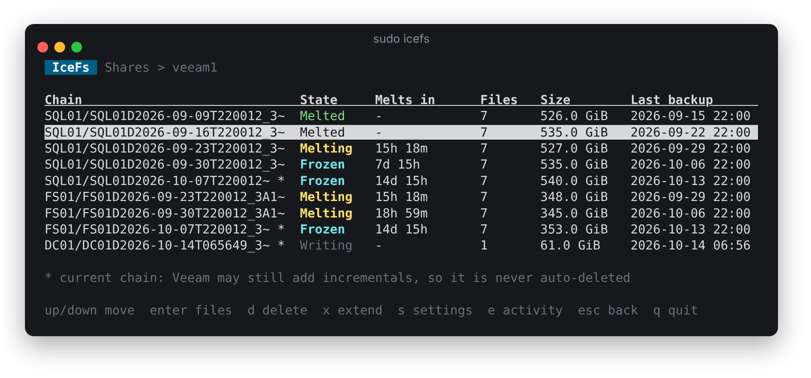
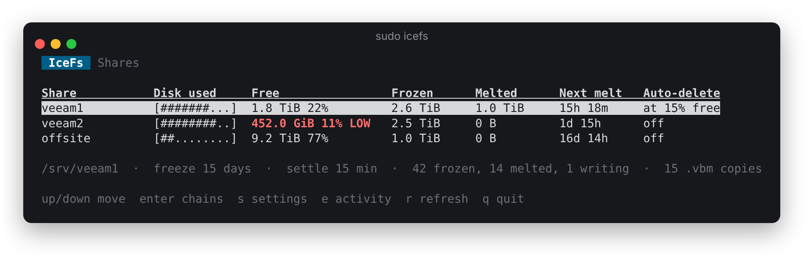
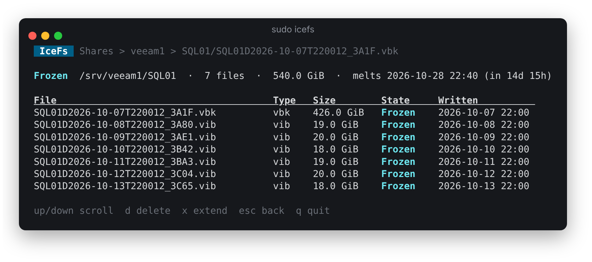
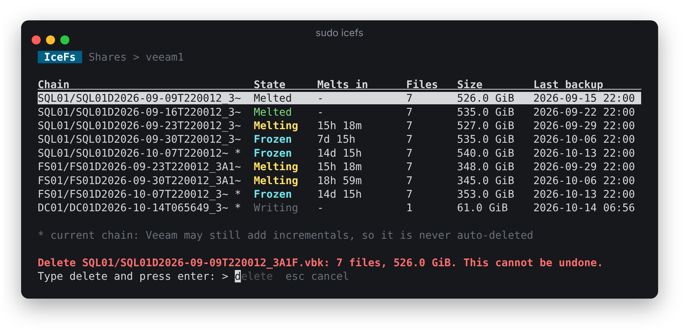
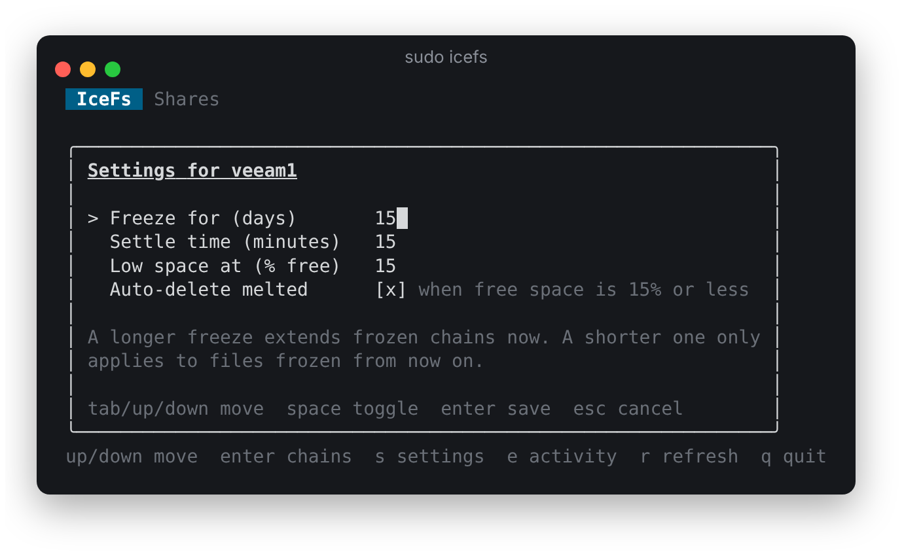
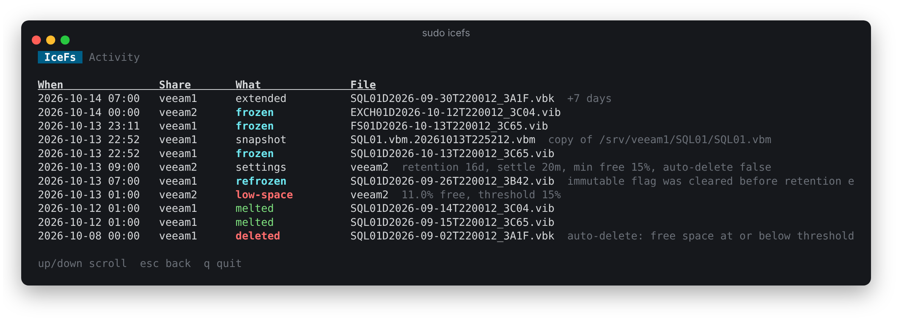

# IceFs

IceFs freezes Veeam backup files on a Linux server so nothing can delete or
change them for a set number of days. When that time is up the files melt and
can be deleted again.

It runs as a root service (`icefsd`) on Debian or Ubuntu next to the Samba
shares Veeam writes to. The `icefs` TUI shows what is frozen and lets you
change settings and delete melted chains.



## How it works

- **Freeze.** Every minute the service scans each share. A `.vbk` or `.vib`
  is frozen with the Linux immutable flag (`chattr +i`) once it has been
  untouched for the settle period (default 15 minutes), no process has it
  open, and the folder's `.vbm` has settled too. Freezing earlier would break
  a running backup.
- **Chains melt together.** A `.vbk` and its `.vib` files form a chain. In
  forward incremental every `.vib` needs the `.vbk` and every earlier `.vib`,
  so the whole chain stays frozen until retention (default 15 days) after its
  newest incremental was frozen, then melts at once. A new active full starts
  a new chain.
- **Metadata copies.** The live `.vbm` changes on every run, so it is never
  frozen. Instead each settled version is copied to
  `<share>/.icefs/vbm/<folder>/<name>.<timestamp>.vbm` and frozen. Older
  copies are removed after retention; the newest copy is always kept.
- **Delete.** Only fully melted chains can be deleted, from the TUI. If
  `auto_delete` is on and free space is at or below `min_free_percent`
  (default 15%), melted chains are deleted oldest first. The newest chain in
  a folder is never auto-deleted because Veeam may still add to it. Frozen
  files are never touched.
- **Tamper check.** If someone clears the flag by hand before retention ends,
  the next scan freezes the file again and logs it.

State lives in SQLite (`/var/lib/icefs/state.db`), so a restart picks up where
it stopped.

## Requirements

- Debian or Ubuntu, run as root (the immutable flag needs `CAP_LINUX_IMMUTABLE`).
- Shares on ext4 or XFS (btrfs also works). NFS and FUSE mounts do not support the flag.
- Veeam jobs in forward incremental **with periodic active fulls**. Pure
  forever-forward merges into the old `.vbk`, which a frozen file blocks.
- Veeam retention no longer than the IceFs retention, or Veeam's cleanup
  will fail on frozen files until they melt.

## Install

Download `icefs_<version>_amd64.deb` (or `arm64`) from the
[releases](https://github.com/sabbakix/icefs/releases), then:

```sh
sudo apt install ./icefs_0.1.0_amd64.deb
sudoedit /etc/icefs/config.toml          # add a [[share]] block per backup folder
sudo systemctl restart icefsd
sudo icefs                               # open the TUI
```

The package installs `icefsd` (service, enabled and started), `icefs` (TUI),
the systemd unit and `/etc/icefs/config.toml`. Removing the package leaves
frozen files frozen; IceFs never unfreezes early. Purging also deletes the
state database in `/var/lib/icefs`.

To build the package yourself: `packaging/deb/build.sh 0.1.0 amd64` (needs Go
and `dpkg-deb`; the result lands in `dist/`). Pushing a `v*` tag builds both
architectures and attaches them to a GitHub release.

Hide the metadata copies from Windows clients by adding this to each share in
`/etc/samba/smb.conf`:

```ini
veto files = /.icefs/
```

## TUI

```sh
sudo icefs
```

The screen refreshes every 5 seconds. `r` refreshes now, `esc` goes back and
`q` quits.

### Shares

Disk use, free space (flagged LOW at the threshold), space held by frozen and
melted files, the next melt and the auto-delete setting for every share.



### Chains

Press `enter` on a share. Each chain shows its state: *Frozen*, *Melting*
(melts within a day), *Melted* (can be deleted) or *Writing* (Veeam is still
on it, not frozen yet), with time left, size and last backup. A `*` marks the
current chain of a job, which is never auto-deleted (screenshot at the top).

Press `enter` again to see a chain's files.



### Delete, extend and settings

- `d` deletes a melted chain. You type `delete` to confirm; frozen chains are
  refused.
- `x` keeps a frozen chain frozen for more days.
- `s` edits the share's freeze days, settle minutes, low-space % and
  auto-delete.





### Activity

`e` shows the log of freezes, melts, deletes, refreezes after tampering and
low-space warnings.



## Local API

The service listens on a root-only unix socket (`/run/icefs/icefs.sock`). The
TUI uses it; you can too:

```sh
sudo curl -s --unix-socket /run/icefs/icefs.sock http://icefs/v1/status
sudo curl -s --unix-socket /run/icefs/icefs.sock http://icefs/v1/shares/veeam1/chains
```

| Method | Path | Does |
| --- | --- | --- |
| GET | `/v1/status` | Shares, settings, disk space, frozen and melted totals |
| GET | `/v1/shares/{share}/chains` | Chains with their files, state and melt time |
| POST | `/v1/shares/{share}/chains/delete` | `{"chain": "<path of .vbk>"}`, melted chains only |
| POST | `/v1/shares/{share}/chains/extend` | `{"chain": "...", "days": 7}` |
| PUT | `/v1/shares/{share}` | `{"retention_days", "settle_minutes", "min_free_percent", "auto_delete"}` |
| GET | `/v1/events?limit=100` | Recent freezes, melts, deletes and warnings |

## Development

```sh
go test ./...
```

Run the tests as root on ext4 or XFS to include the test that sets the real
immutable flag; elsewhere it is skipped.

The screenshots in `docs/screenshots` come from the real TUI running against
a demo API with made-up shares (`docs/screenshots/demo`). To retake them after
a TUI change, with Go, tmux, python3, ImageMagick and Chromium installed:

```sh
docs/screenshots/capture.sh              # set CHROME=/path/to/chromium if needed
```
